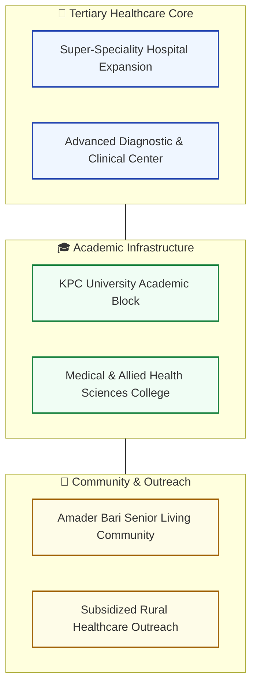
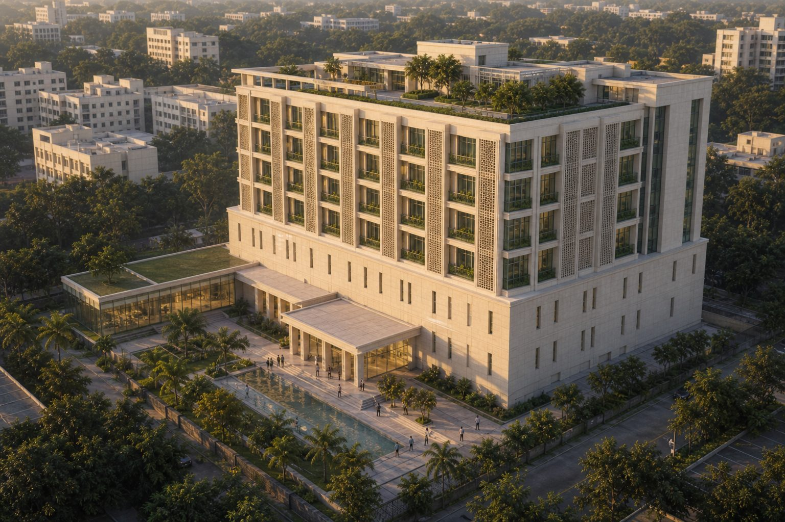
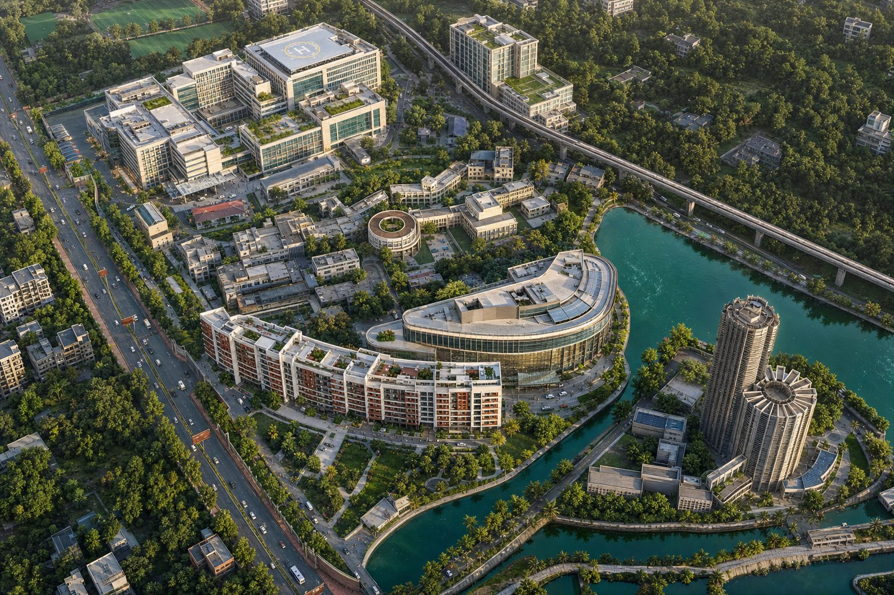
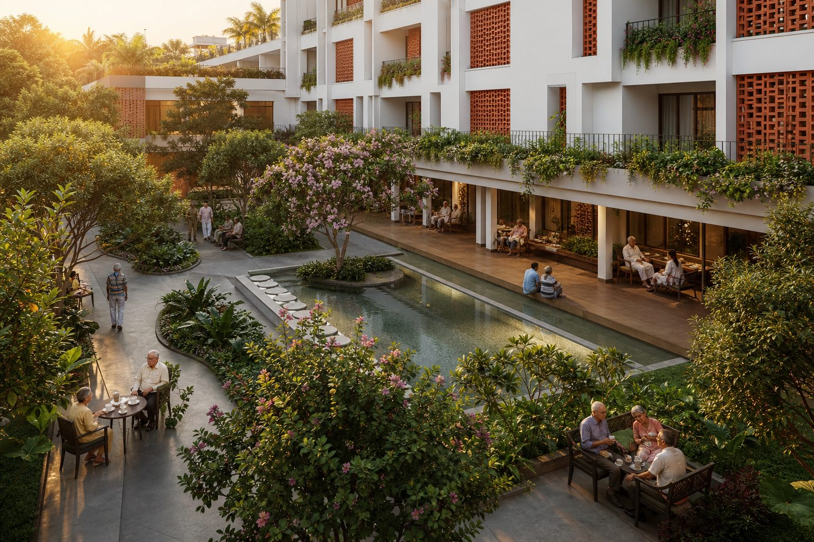

# KPC Integrated Healthcare & Education Proposal (West Bengal)

**Stakeholder preview portal for the integrated healthcare, medical college, and university expansion proposal (VJN001).**

[🌐 View the Live Proposal Site](https://sayan-bhattacharya.github.io/kpc-integrated-proposal/)

---

## 📌 Project Overview

This interactive preview site presents the comprehensive proposal for the KPC Group's healthcare and education expansion in West Bengal. It features an interactive slide viewer, architectural 3D campus models, downloadable proposal documents, and motion media assets.

---

## 🏛️ Integrated Proposal Structure

---

## 🖼️ Architectural & Motion Assets

### KPC University Campus 3D Master Plan

---

### Jadavpur Integrated Campus 3D Visualisation

---

### Amader Bari Community Care

---

## 📬 Contact

- **Lead Consultant / Architect**: Sayan Bhattacharya
- **Email**: [sayanpm17@gmail.com](mailto:sayanpm17@gmail.com)
- **LinkedIn**: [linkedin.com/in/snbhattacharya5](https://www.linkedin.com/in/snbhattacharya5/)
